# KSM в Linux

### Когда экономия памяти меняет задержки

**Kernel Samepage Merging** позволяет Linux хранить одну физическую страницу вместо нескольких одинаковых. Мы проверили, сколько памяти это экономит, сколько ЦП занимает `ksmd` и где эффект заметен в хвостах задержки HTTP и тиков игровых серверов.

> **209 МиБ** экономии у восьми контейнеров Python на нативном Arch. **+19,3%** к p99.9 HTTP-задержки у JVM в одной из парных серий. Для **трёх тик-серверов** устойчивый сдвиг p99.9 работы тика остался неопределённым.

[Зачем измеряли](#зачем-измеряли) · [VirtualBox](#virtualbox-где-заметен-эффект) · [ВМ и железо](#вм-и-железо-что-перенеслось) · [Нативные эксперименты](#нативный-arch-http-и-тики) · [Как измеряли](#как-измеряли) · [Данные и воспроизведение](#данные-и-воспроизведение)

| Где смотреть | Сводки и прогоны | Галерея |
|---|---|---|
| **VirtualBox** · этапы 0–2 | [Память, COW и HTTP в ВМ](results/vm/) | [15 PNG](figures/png/vm/) · [SVG](figures/svg/vm/) |
| **Нативный Arch** · этапы 3–4 | [Тепловой режим, парный HTTP и тики](results/native/) | [7 PNG](figures/png/native/) · [SVG](figures/svg/native/) |
| **ВМ и железо** · этап 3 | [Сопоставление сред](results/comparison/) | [9 PNG](figures/png/comparison/) · [SVG](figures/svg/comparison/) |

## Зачем измеряли

Экономия памяти сама по себе мало говорит о том, стоит ли включать KSM на сервере. `ksmd` расходует ЦП, пока ищет совпадения, а запись в слитую страницу может потребовать её копирования. У веб-сервера это может быть заметно в редких медленных ответах, у игрового сервера — в длинных интервалах между тиками. Поэтому каждый эффект проверяли отдельно.

| Серия | На какой вопрос отвечает |
|---|---|
| **VirtualBox** | Сколько анонимной памяти можно сэкономить, как на это влияют число контейнеров и настройки сканирования, сколько стоит первая запись после слияния? |
| **Повтор на железе** | Повторяются ли результаты ВМ, когда меняются среда и фоновые задержки таймера? |
| **Парные HTTP-прогоны** | Как меняется задержка запросов Python и JVM при KSM? Позволяет ли точность измерений подтвердить эквивалентность в заранее выбранных пределах? |
| **Тик-серверы и привязка** | Меняются ли время работы тика и ритм тиков у C-сервера, Luanti и Godot? Зависит ли хвост у C-сервера от того, где работает `ksmd`? |

## VirtualBox. Где заметен эффект

### Сколько памяти освободилось

С увеличением числа контейнеров рисунок изменился по-разному для каждой нагрузки. У Python в коротких прогонах с настройками по умолчанию `ksmd` не всегда успевал закончить слияние, поэтому часть точек обозначает нижнюю границу. Более длинная серия дала **198,9 МиБ** экономии для восьми контейнеров Python. [Отчёт ВМ](docs/stage-2.md#результаты)

[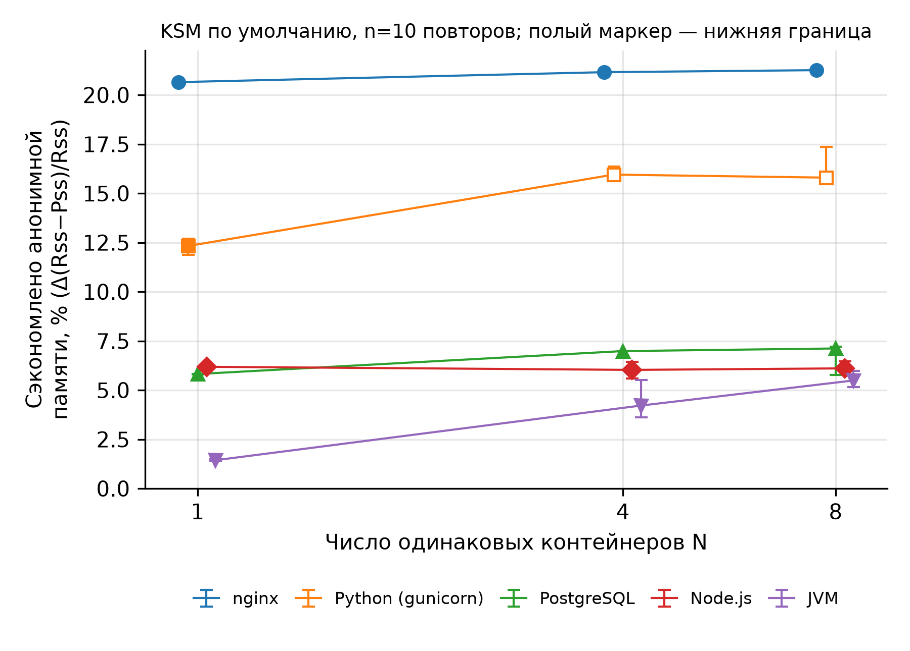](figures/svg/vm/stage1-savings-vs-n.svg)

### Где удлинился хвост HTTP

В фазе слияния у Python p99 выросла на **16,1 мс** (95% ДИ от +9,1 до +21,2 мс). В устойчивой фазе интервал для Python уже включает ноль. [Сводка HTTP-прогонов ВМ](results/vm/summary/stage2-load-compare.csv)

[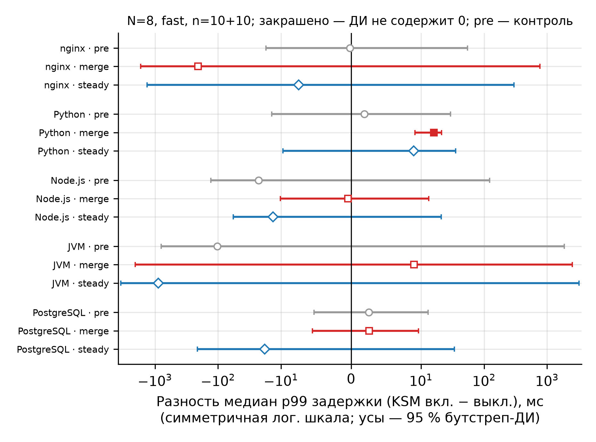](figures/svg/vm/stage2-p99-diff.svg)

## ВМ и железо. Что перенеслось

### Экономия памяти и цена сканирования

При восьми контейнерах под HTTP-нагрузкой Python сэкономил **211 МиБ в ВМ** и **209 МиБ на железе**. Для JVM — **48 и 191 МиБ** соответственно. На железе `ksmd` занимал **3,2–8,6% одного логического ЦП**, в ВМ — **11–22%**. Версии контейнерных образов между сериями различались. [Сравнительная сводка](results/comparison/summary/stage3-load-vm-vs-native.csv) · [Ограничения](docs/limitations.md#л9-нативная-система-другое-ядро-цп-и-образы-этап-3)

[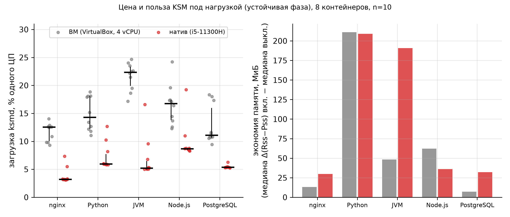](figures/svg/comparison/stage3-load-cost.svg)

### Насколько отличается фон измерения

В нативном повторе изменение p99 Python в фазе слияния составило **+0,04 мс** (95% ДИ от −0,88 до +1,54 мс). Отдельный контроль в простое также показал разные масштабы джиттера: p99 опоздания таймера **84–85 мкс на железе** и **20–29 мс в ВМ**. [Отчёт о сравнении](docs/stage-3.md#итоги-2026-11-19)

[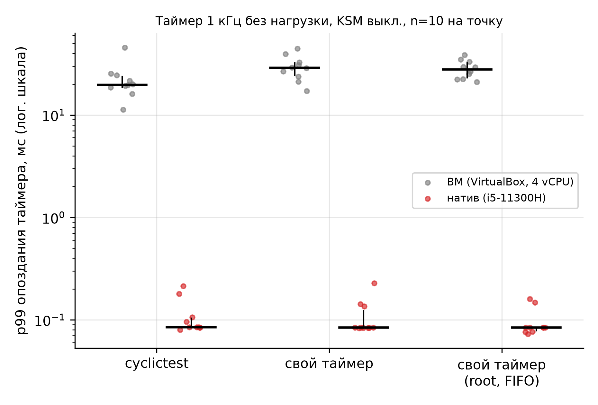](figures/svg/comparison/stage3-timer-jitter.svg)

## Нативный Arch. HTTP и тики

### Дал ли KSM заметный рост HTTP-задержки

В устойчивой фазе у JVM p99.9 выросла на **19,3%** (95% ДИ от +10,0 до +23,8%). На графике показаны **90% ДИ** для проверки эквивалентности. Голубая полоса — заранее выбранный допустимый диапазон отношений от 1/1,2 до 1,2. [Отчёт парного эксперимента](docs/stage-4.md#блок-0--результаты)

[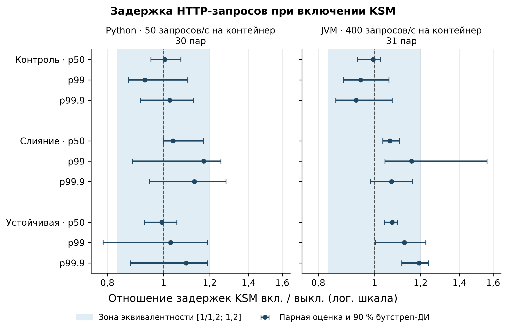](figures/svg/native/stage4-eq-ratio.svg)

### Что произошло с тиками

В устойчивой фазе медиана парного изменения **p50 работы тика** составила **+0,160 мс для C-сервера** и **+0,192 мс для Godot**. У Luanti интервал включает ноль. Для **p99.9** 95% ДИ включали ноль у всех трёх нагрузок. График p99.9 показывает межквартильный разброс пар, доверительные интервалы приведены в отчёте. [Серия Б и интервалы](docs/stage-4-results.md#блок-б-работа-тика-в-устойчивой-фазе)

[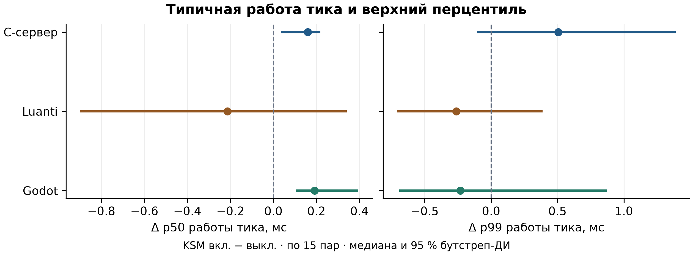](figures/svg/native/stage4-block-b-work.svg)

[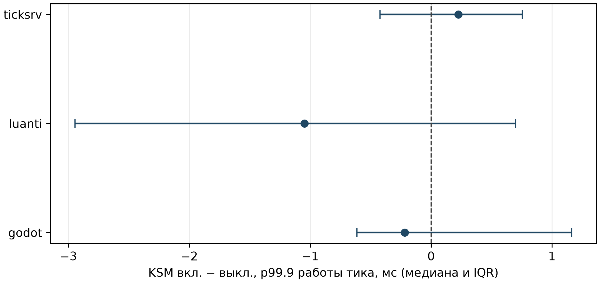](figures/svg/native/stage4-block-b-p999.svg)

<details>
<summary><strong>Медленные тики и интервалы длиннее 1,5 периода</strong></summary>

1% low — темп самых медленных 1% тиков. Длинным считали интервал больше 1,5 периода. Для обеих метрик парные 95% ДИ включили ноль у всех трёх нагрузок.

[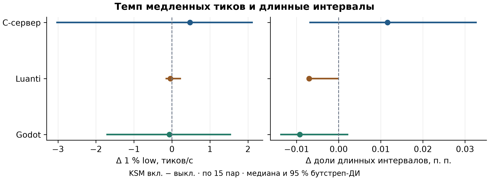](figures/svg/native/stage4-block-b-cadence.svg)

</details>

### Помогла ли привязка `ksmd`

У `shared` и `split` медианы p99.9 по конфигурациям составили **13,971 и 12,614 мс**. Внутри одинаковых номеров повторов медиана разности составила **+0,265 мс** (95% ДИ от −1,273 до +3,812 мс). Данных недостаточно для уверенного вывода об эффекте привязки. [Анализ блока В](docs/stage-4.md#итоги-этапа-4)

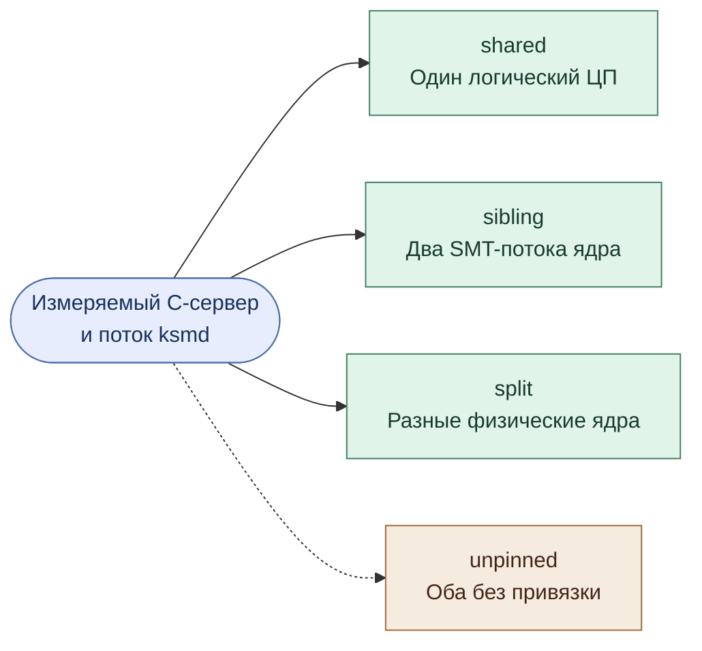

[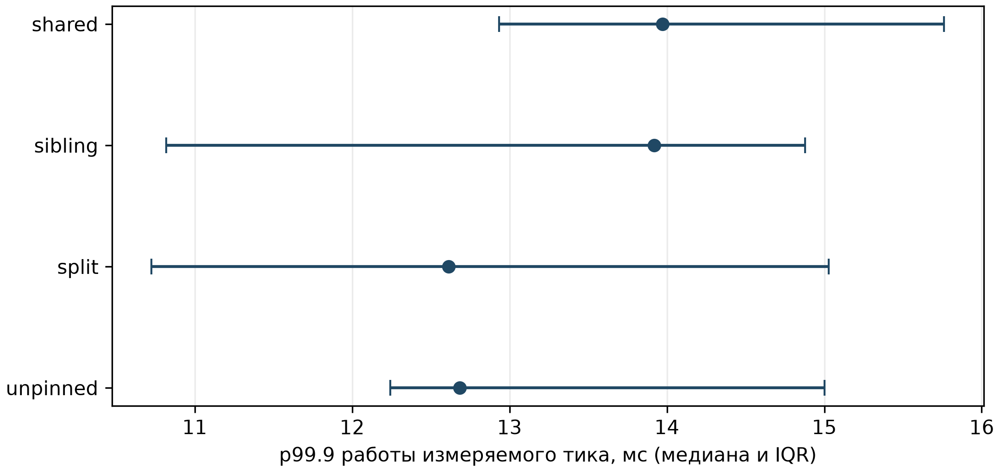](figures/svg/native/stage4-block-v-p999.svg)

### В каких условиях получены эти числа

Luanti и Godot троттлили во всех 30 прогонах каждого движка. Максимумы — **98 и 95 °C** соответственно. Этот тепловой режим ограничивает переносимость результатов на другое железо. [Телеметрия и ограничения](docs/limitations.md#л15-нагрев-в-пилоте-серверов-с-тиком)

[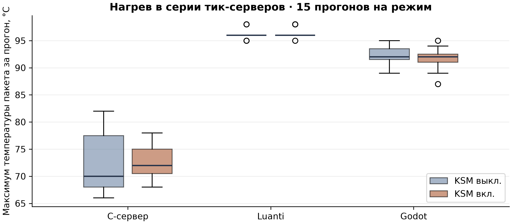](figures/svg/native/stage4-block-b-thermal.svg)

## Как измеряли

### Условия и порядок прогона

Первые замеры сделали на Arch Linux в VirtualBox (4 vCPU, ядро 7.2.9), ключевые серии повторили на ноутбуке с нативным Arch (Intel Core i5-11300H, 8 логических ЦП, ядро 7.3.4). В основных нагрузочных сериях запускали восемь контейнеров одной нагрузки. [Снимок ВМ](env/vm-oracle/) · [Снимок нативной системы](env/native/)

1. **Сбрасывали состояние.** Скрипт останавливал контейнеры предыдущего прогона, разъединял слитые страницы, сбрасывал файловый кэш и выдерживал паузу. Перед замером нагрузку прогревали.
2. **Меняли доступность слияния для процессов.** В варианте «вкл.» лаунчер разрешал KSM для памяти приложения через `prctl`, в варианте «выкл.» оставлял её вне слияния. Параметры нагрузки внутри сравнения совпадали.
3. **Разделяли измерение на фазы.** Контрольное окно шло до включения сканирования KSM. Затем начиналось окно слияния, за ним — позднее окно, которое в отчётах называется устойчивой фазой. В серии Б эти окна длились **30, 60 и 90 секунд** соответственно. Границы фаз были одинаковы для обеих сторон сравнения.
4. **Повторяли и сводили результаты.** В парной HTTP-серии собрано 30 пар для Python и 31 для JVM. В основной серии тик-серверов было 15 пар на нагрузку, в опыте с привязкой — по 10 прогонов на вариант. Порядок «вкл.» и «выкл.» внутри пары менялся между повторами. Сначала считали метрики каждого прогона, потом разность или отношение внутри пары. Разброс и доверительные интервалы оценивали по повторам.
5. **Записывали условия.** Вместе с замерами сохраняли параметры запуска, версию окружения, события `perf` и счётчики ядра. В нативных сериях также фиксировали температуру, частоты, троттлинг и состояние питания.

[Сброс состояния](scripts/lib/common.sh) · [Сценарий серии Б](scripts/stage4-block-b.sh) · [Решения по методике](docs/decisions.md)

### Что именно попало на графики

| Метрика | Как считали |
|---|---|
| **Экономия памяти** | Суммировали анонимные RSS и PSS по процессам контейнеров. PSS делит физическую страницу между её пользователями. Вклад KSM оценивали по изменению разности RSS − PSS относительно контрольного режима. |
| **Стоимость по ЦП** | Измеряли процессорное время потока `ksmd` и выражали его в процентах от времени одного логического ЦП. |
| **Задержка HTTP** | Генератор отправлял запросы по расписанию с заданной частотой. Задержку считали от запланированного времени отправки до завершения ответа, чтобы учесть очередь при опоздании самого генератора. |
| **Время работы и ритм тика** | Длительность работы — от начала до конца измеряемого участка. Для Luanti и Godot это измерялось внутри callback. Ритм считали по времени между началами соседних тиков. Длинным считали интервал больше 1,5 номинального периода. |

[HTTP-генератор](workloads/loadgen/) · [Сбор метрик памяти](scripts/lib/ctr_mem_sampler.py) · [Измерение тиков](workloads/ticksrv/README.md)

### Откуда берётся экономия и когда появляется COW

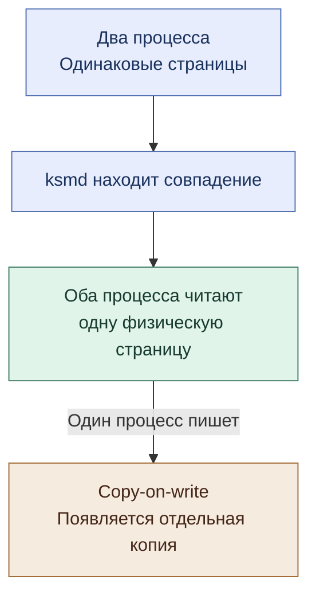

### Что сравнивается внутри пары

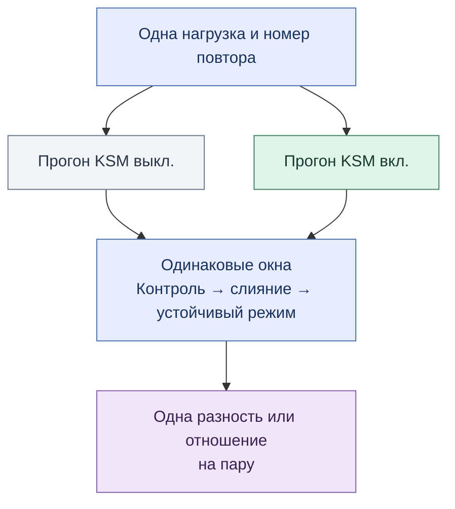

Такая схема сравнения помогает учесть дрейф условий между повторами. Масштаб фонового шума ВМ и троттлинг движков на железе учитываются при интерпретации. [Ограничения](docs/limitations.md)

## Данные и воспроизведение

| Что нужно | Где искать |
|---|---|
| Найти эксперимент и его отчёт | [Карта исследования](docs/MAP.md) |
| Сверить график с числом | [ВМ](results/vm/) · [Нативный Arch](results/native/) · [Сравнение](results/comparison/) |
| Проверить исходные данные и SHA-256 | [Описание данных и полных трасс](docs/DATA.md) |
| Повторить измерения | [Инструкция для Linux](docs/REPRODUCE.md) · [Тик-серверы](workloads/ticksrv/README.md) |

Построить два набора нативных графиков из готовых CSV. Понадобятся Python, pandas и Matplotlib.

```bash
python3 scripts/plot-stage4-eq.py
python3 scripts/plot-stage4-native.py
```

Обозначения p50, p99 и p99.9 соответствуют 50-му, 99-му и 99,9-му перцентилям. На графиках IQR — отрезок от первого до третьего квартиля, а ДИ описывает неопределённость оценки.
