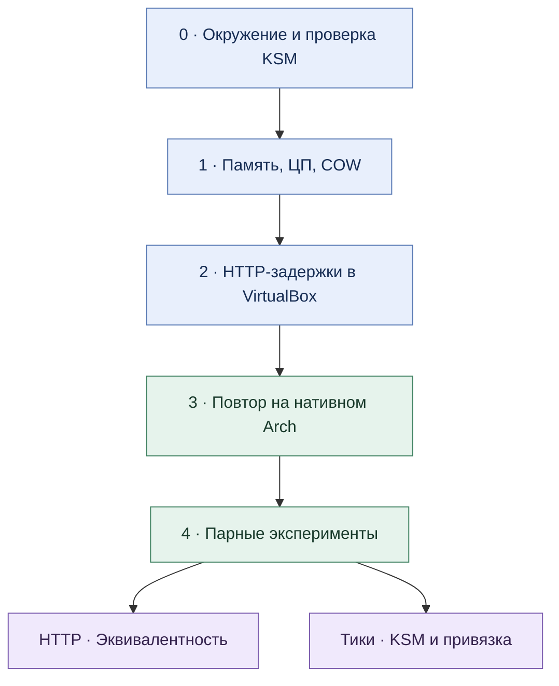
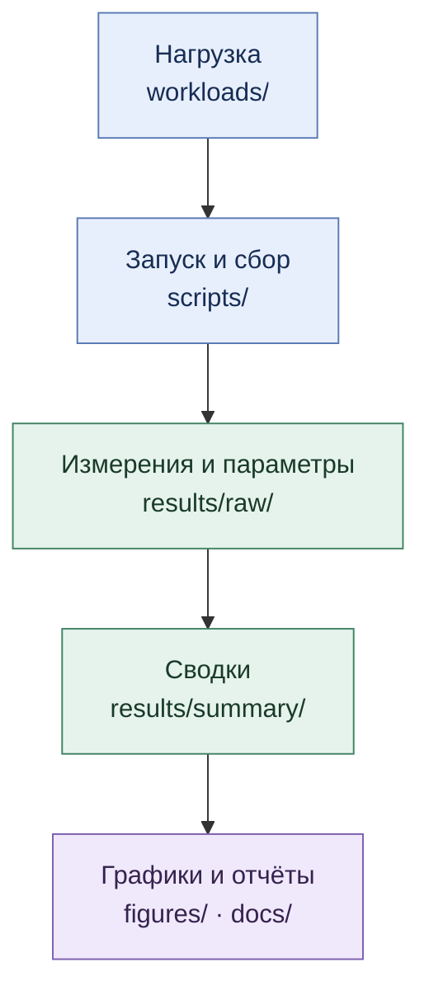

# Карта исследования KSM

[Главная](../README.md) · [ВМ](../results/vm/) · [Нативный Arch](../results/native/) · [Сравнение](../results/comparison/) · [Воспроизведение](REPRODUCE.md)

## Этапы

| Этап | Что проверили | Отчёт |
|---|---|---|
| 0 | Интерфейс KSM, наследование `prctl`, шум таймера | [Окружение и базовая линия](stage-0.md) |
| 1 | Экономия анонимной памяти, параметры сканирования, цена первой записи после слияния | [Память и COW](stage-1.md) |
| 2 | HTTP-задержка под нагрузкой, привязка `ksmd`, события ядра в ВМ | [Измерения в VirtualBox](stage-2.md) |
| 3 | Повтор ключевых серий на ноутбуке с нативным Linux | [Сравнение ВМ и железа](stage-3.md) |
| 4 | Парная HTTP-серия, C-сервер, Luanti, Godot и привязка `ksmd` | [Итог этапа](stage-4.md#итоги-этапа-4) · [Таблицы Б и В](stage-4-results.md) |

## Как проследить результат до исходных данных

| Результат | Таблица | График |
|---|---|---|
| Экономия памяти и цена `ksmd` под нагрузкой | [ВМ и нативный Arch](../results/summary/stage3-load-vm-vs-native.csv) | [PNG](../figures/png/comparison/stage3-load-cost.png) · [SVG](../figures/svg/comparison/stage3-load-cost.svg) |
| Эффект KSM на p99 HTTP в ВМ | [Сравнения по фазам](../results/summary/stage2-load-compare.csv) | [PNG](../figures/png/vm/stage2-p99-diff.png) · [SVG](../figures/svg/vm/stage2-p99-diff.svg) |
| Эквивалентность HTTP-задержек | [Парные отношения](../results/summary/stage4-eq-paired.csv) | [PNG](../figures/png/native/stage4-eq-ratio.png) · [SVG](../figures/svg/native/stage4-eq-ratio.svg) |
| p99.9 работы тика в серии Б | [Парные разности](../results/summary/stage4-ticks-block-b-paired.csv) | [PNG](../figures/png/native/stage4-block-b-p999.png) · [SVG](../figures/svg/native/stage4-block-b-p999.svg) |
| p50 и p99 работы тика | [Парные разности](../results/native/summary/stage4-ticks-block-b-paired.csv) | [PNG](../figures/png/native/stage4-block-b-work.png) · [SVG](../figures/svg/native/stage4-block-b-work.svg) |
| 1 % low и длинные интервалы | [Парные разности](../results/native/summary/stage4-ticks-block-b-paired.csv) | [PNG](../figures/png/native/stage4-block-b-cadence.png) · [SVG](../figures/svg/native/stage4-block-b-cadence.svg) |
| Температура пакета в серии Б | [Телеметрия прогонов](../results/native/summary/stage4-ticks-final-per-run.csv) | [PNG](../figures/png/native/stage4-block-b-thermal.png) · [SVG](../figures/svg/native/stage4-block-b-thermal.svg) |
| p99.9 при разных привязках `ksmd` | [Сводка блока В](../results/summary/stage4-ticks-block-v-summary.csv) | [PNG](../figures/png/native/stage4-block-v-p999.png) · [SVG](../figures/svg/native/stage4-block-v-p999.svg) |

Обозначения и методика описаны в [решениях](decisions.md), отличия машин и ограничения — в [отчёте об ограничениях](limitations.md), источники — в [библиографии](references.md).
