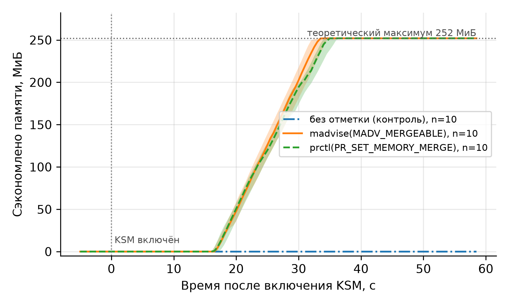
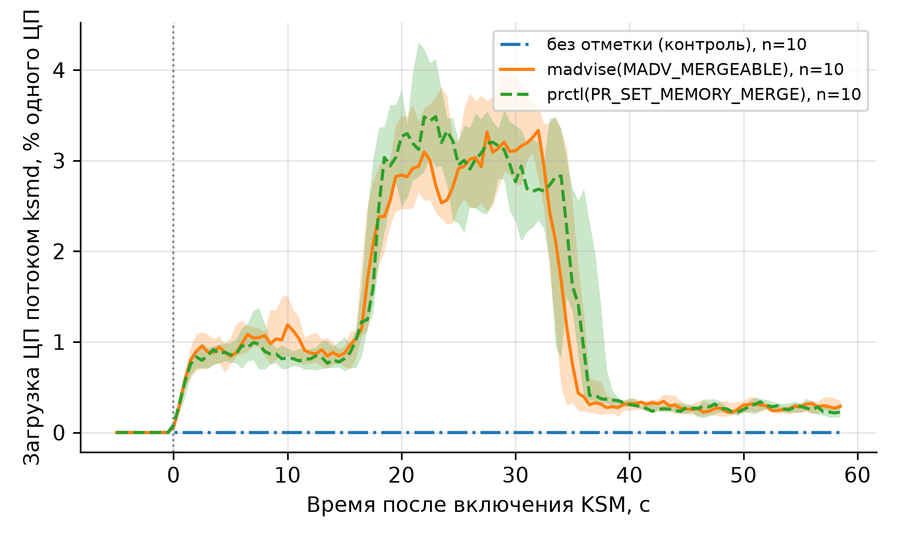
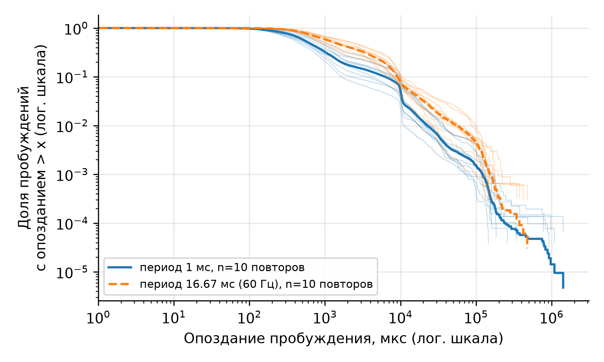

# Этап 0. Подготовка окружения и проверка работы KSM

## План

Статус: **подтверждён владельцем 2026-10-16** (с уточнениями: строгая методика для статьи, скрипты без привязки к VirtualBox, zram не отключать, решения в decisions.md объяснять просто).

Исходные данные (разведка только чтением, 2026-10-16):
- ядро `7.2.9-arch1-1`, VirtualBox (`systemd-detect-virt` → `oracle`), 4 vCPU, 7.6 ГиБ ОЗУ;
- swap: **zram 4 ГиБ** (не диск), это влияет на учёт памяти и будет отмечено в limitations;
- KSM выключен (`run=0`), в sysfs есть `smart_scan=1`, `advisor_mode`, `ksm_zero_pages`, `general_profit`, `use_zero_pages=0`;
- sudo работает без пароля; все нужные пакеты есть в репозиториях Arch (`perf` и `jdk-openjdk` называются так же).

Шаги:

1. **Репозиторий.** `git init`, каталоги измерений, сценариев и отчётов, `.gitignore` для временных файлов.
2. **Инструменты.** `pacman -S --needed` для podman, stress-ng, sysstat, perf, asciinema, tmux, jq, python-numpy/pandas/matplotlib/scipy, nodejs, jdk-openjdk, htop, gcc, linux-docs (локальная документация ядра своей версии). Версии записываются в `env/packages.txt`.
3. **Фиксация окружения.** Скрипт `scripts/capture-env.sh` пишет в `env/`: uname, lscpu, free, /proc/meminfo, swap/zram, все файлы `/sys/kernel/mm/ksm/`, параметры ВМ (dmesg/DMI, clocksource, governor, THP). В `env/ksm-features.md` описывается, какие возможности KSM есть в 7.2 по `Documentation/admin-guide/mm/ksm.rst` (из linux-docs): prctl `PR_SET_MEMORY_MERGE`, smart scan, advisor, `ksm_zero_pages`, `general_profit`, `/proc/<pid>/ksm_stat`, `ksm_merging_pages`.
4. **Скиллы** в `.claude/skills/`: `experiment-journal`, `run-experiment`, `make-figures` (у каждого SKILL.md с frontmatter `name`/`description`, инструкции на русском).
5. **Проверка KSM на простом примере.** Программа на C `workloads/ksm-probe/` выделяет N МиБ одинаковых страниц, режимы `madvise` и `prctl`. Скрипт `scripts/ksm-probe-run.sh` сбрасывает состояние, включает KSM, раз в 0.5 с снимает `pages_shared`, `pages_sharing`, `full_scans`, `general_profit` и CPU ksmd (из `/proc/<pid ksmd>/stat`), пишет CSV и .json параметров. 10 повторов на каждый режим, в tmux. График `figures/png/vm/stage0-ksm-savings.png`: экономия МиБ во времени, медиана и IQR по повторам.
6. **Наследование prctl и контейнеры.** Тестовая программа ставит `PR_SET_MEMORY_MERGE`, затем (а) fork, (б) exec, (в) fork+exec. Проверка по `prctl(PR_GET_MEMORY_MERGE)` и по факту слияния (`/proc/<pid>/ksm_merging_pages`). Затем podman: запуск через обёртку-лаунчер, которая ставит prctl и делает exec в `podman run` (проверяем, доходит ли флаг до процесса в контейнере через conmon/runc/crun), и альтернатива: лаунчер внутри образа как ENTRYPOINT. Вывод и выбранный способ пишутся в `docs/decisions.md`.
7. **Шум ВМ.** `workloads/jitter/` на C: цикл `clock_nanosleep(TIMER_ABSTIME)` с периодами 1 мс и 16.67 мс, 60 с на прогон, 10 повторов, KSM выключен, без нагрузки. Распределение отклонений (p50/p99/p99.9/max), гистограмма `figures/png/vm/stage0-timer-jitter.png`. Результат и прочие искажения пишутся в `docs/limitations.md`.
8. **Отчёт и коммит.** `docs/journal.md`, `docs/references.md`, раздел «Результаты» в этом файле, затем `git commit` и остановка.

Сознательно не делаю: не трогаю загрузчик и параметры ядра (isolcpus и т.п.), не отключаю zram, не меняю настройки VirtualBox. Если какой-то из этих шагов понадобится, предложу его отдельно.

---

## Что сделано

| № | Шаг плана | Статус |
|---|---|---|
| 1 | Репозиторий и структура | выполнено. Добавлены `results/logs/` (логи tmux-серий) и `.gitignore` (бинарники собираются из исходников) |
| 2 | Инструменты | выполнено. Сверх плана установлены `man-db`, `man-pages` (поиск описания prctl) и `rt-tests` (cyclictest для перекрёстной проверки). Ядро не обновлялось (`pacman -S` без `-y`). Версии в `env/vm-oracle/packages.txt` |
| 3 | Фиксация окружения | выполнено: `scripts/capture-env.sh` → `env/vm-oracle/` (26 файлов), возможности KSM в `env/ksm-features.md` |
| 4 | Скиллы | выполнено: `.claude/skills/{experiment-journal,run-experiment,make-figures}/SKILL.md`. Плюс общая инфраструктура: `scripts/lib/common.sh` (сброс состояния), `runinfo.py` (JSON параметров), `ksm_sampler.py`, `tmux-run.sh`/`tmux-wait.sh` |
| 5 | Проверка KSM (madvise и prctl), график | выполнено: пилот + серия 3 режима × 10 повторов. Добавлены две независимые проверки экономии (Pss процесса, AnonPages системы) и график CPU ksmd |
| 6 | Наследование prctl, podman | выполнено: 8 конфигураций × 2 настройки ksmd × 10 повторов = 160 прогонов. Сверх плана: режим «агрессивный ksmd» (известная гонка из LKML), вариант systemd `MemoryKSM=`, диагностика, какие процессы получают флаг |
| 7 | Шум ВМ | выполнено с изменением: до серии найдены и исправлены две методические ошибки (cyclictest фактически работал в SCHED_FIFO; наша программа догоняла пропущенные тики). Добавлена перекрёстная проверка cyclictest |
| 8 | Отчёт, коммит | этот документ |

## Результаты

### 1. KSM работает и экономит ровно столько, сколько предсказывает теория

**Вопрос.** Работает ли KSM в ядре 7.2.9 на этой системе, одинаково ли работают `madvise` и `prctl`, правильно ли мы измеряем?

**Методика.** `ksm_probe`: 256 МиБ (65536 страниц), 1024 варианта содержимого, каждый повторяется 64 раза. Теория: `pages_shared = 1024`, `pages_sharing = 64512`, экономия 252.0 МиБ. KSM с параметрами по умолчанию (100 страниц / 20 мс), THP = always, 60 с наблюдения, 10 повторов на режим, порядок режимов по кругу. Скрипт `scripts/stage0-ksm-probe.sh`.

**Числа** (`results/summary/stage0-ksm-probe.csv`), медиана [Q1–Q3], n = 10:

| Метрика | none (контроль) | madvise | prctl |
|---|---|---|---|
| Экономия в конце, МиБ (теория 252.0) | 0 | 252.0 [252.0–252.0] | 252.0 [252.0–252.0] |
| `pages_shared` (теория 1024) | 0 | 1024 | 1024 |
| Время до 50 % экономии, с | — | 25.1 [24.2–26.2] | 25.8 [24.9–26.4] |
| Время до 100 % экономии, с | — | 33.6 [32.2–35.0] | 34.8 [34.0–36.4] |
| ЦП ksmd до схождения, с ЦП | — | 0.72 [0.58–0.79] | 0.70 [0.60–0.80] |
| то же, % одного ЦП | — | 2.09 [1.72–2.34] | 2.04 [1.75–2.22] |
| ЦП ksmd после схождения, % | 0 | 0.30 [0.24–0.34] | 0.28 [0.24–0.31] |
| Уменьшение AnonPages системы, МиБ | −0.1 [−6.2–0.9] | 252 [244–253] | 251 [249–253] |
| Pss_Anon процесса до → после, КиБ | 262196–262200 → 262196–262200 | 262196–262200 → 4148–4152 | 262196 → 4148 |
| Разбито huge-страниц | 0 | 128 | 128 |
| `cow_ksm` | 0 | 0 | 0 |

**Вывод.** KSM работает. Счётчики KSM, Pss процесса и AnonPages системы дают одинаковую экономию, совпадающую с теорией. Значит, измерительный пайплайн откалиброван. madvise и prctl по экономии неотличимы. По времени и ЦП их IQR перекрываются, и разницы мы не утверждаем. При настройках по умолчанию KSM медленный (≈4100 страниц/с) и дешёвый (≈2 % одного ЦП при слиянии). В первые ≈16 с (первый полный проход) слияний нет совсем. Ограничение: нагрузка искусственная, страницы после заполнения не меняются.

### 2. prctl(PR_SET_MEMORY_MERGE) наследуется через fork и exec и доходит до контейнера

**Методика.** Целевой процесс сам KSM не включает. Флаг ставится предком 6 разными способами и в 2 контрольных вариантах не ставится. Каждый вариант прогоняется при настройках ksmd по умолчанию и агрессивных (20000 стр./0 мс), по 10 повторов. Скрипт `scripts/stage0-prctl-inherit.sh`.

**Числа** (`results/summary/stage0-prctl-inherit.csv`): флаг у целевого процесса при старте / память слилась (≥ 99 % страниц):

| Способ | default | aggressive |
|---|---|---|
| host-control (без флага) | 0/10 / 0/10 | 0/10 / 0/10 |
| host-fork (prctl → fork) | 10/10 / 10/10 | 10/10 / 10/10 |
| host-exec (prctl → exec) | 10/10 / 10/10 | 10/10 / 10/10 |
| host-fork-exec | 10/10 / 10/10 | 10/10 / 10/10 |
| ctr-control (podman, без флага) | 0/10 / 0/10 | 0/10 / 0/10 |
| ctr-outer (`ksm_launch podman run …`) | 10/10 / 10/10 | 10/10 / 10/10 |
| ctr-inner (`podman run … ksm_launch …`) | 10/10 / 10/10 | 10/10 / 10/10 |
| ctr-systemd (`MemoryKSM=yes`) | 10/10 / 10/10 | 10/10 / 10/10 |

Диагностика (1 запуск, `results/raw/stage0-prctl-diag/`): при ctr-outer флаг получают ещё `podman` (21.8 МиБ анонимной памяти) и `conmon`, при ctr-inner только приложение.

**Вывод.** В 7.2.9 флаг надёжно наследуется (120/120 и 0/40 в контролях). Известную гонку из LKML (2025) воспроизвести не удалось. Выбран способ «лаунчер внутри контейнера» (обоснование в `docs/decisions.md`, Р11). Проверен только podman rootless + crun.

### 3. Шум ВМ огромен: базовая линия задержки — миллисекунды, хвост — сотни миллисекунд

**Методика.** Простой, KSM выключен, SCHED_OTHER. Наша `timer_jitter` (1 мс и 60 Гц) и cyclictest (1 мс), по 60 с × 10 повторов. Пропущенные периоды пропускаются. Скрипт `scripts/stage0-jitter.sh`.

**Числа** (`results/summary/stage0-jitter.csv`), медиана [Q1–Q3]:

| Период | p50 | p99 | p99.9 | Пропущено тиков |
|---|---|---|---|---|
| 1 мс | 0.61 [0.54–0.82] мс | 21 [18–32] мс | 121 [84–145] мс | 66 [58–74] % |
| 16.67 мс (60 Гц) | 1.39 [1.10–1.77] мс | 52 [34–59] мс | 140 [122–167] мс | 8.6 [6.6–10.1] % |
| 1 мс, cyclictest | 0.53 [0.47–0.70] мс | 15.8 [11.8–18.3] мс | ≥ 100 мс | н/д |

Максимумы за прогон до 1.4–1.5 с. Steal = 0 во всех 30 прогонах.

**Вывод.** На этой ВМ даже в простое тик 60 Гц пропускается в ~9 % случаев, а отдельные остановки длятся сотни миллисекунд. Источник — гипервизор (гость простаивает), но гость его не видит (steal = 0). Эффекты KSM на задержки меньше нескольких миллисекунд здесь на уровне p99 неразличимы. ВМ годится для отладки пайплайна и сравнения конфигураций внутри одной серии, а абсолютные задержки для статьи нужно получать на нативной системе. Подробно в `docs/limitations.md`, Л4.

## Проблемы и ограничения

1. **Расхождение с cyclictest по p90 и числу пробуждений** (наша программа просыпается реже: 20 тыс. против 28 тыс. за 60 с, p90 3.8–9.3 против 1.7–2.3 мс). Совпадение политики, nice, cgroup и ЦП проверено, причина не найдена. Открытый вопрос, на ВМ абсолютные хвосты нашей программы считаются завышенными.
2. **Две методические ошибки найдены и исправлены до серии** (журнал, 20:35): `-p 0` у cyclictest включал SCHED_FIFO; первая версия `timer_jitter` догоняла пропущенные тики и раздувала квантили. Данных с ошибками в `results/` нет.
3. Проверочная нагрузка искусственная (неизменная память, один процесс). Реальные приложения будут сливаться хуже.
4. Наследование prctl проверено только для podman rootless + crun на ядре 7.2.9.
5. В той же ВМ работает агент Claude Code (≈3–4 % ЦП в простое). Это часть шума всех замеров (`docs/limitations.md`, Л1а).
6. THP = always: KSM разбивает все huge-страницы нагрузки (128 из 128). Влияние на скорость и задержки не измерялось.

## Что дальше (предложения на этап 1, требуют подтверждения)

1. **Доработать `ksm_launch`**: режим без prctl (переменная окружения), чтобы в конфигурации «KSM выкл.» дерево процессов совпадало с «KSM вкл.».
2. **Мини-серия по расхождению с cyclictest**: наша программа от обычного пользователя / от root / cyclictest, 10 повторов. Если расхождение не объяснится, использовать cyclictest как эталон шума.
3. **Первые реальные нагрузки**: N одинаковых контейнеров (nginx, Python, Node.js, JVM, PostgreSQL), N = 1…8. Экономия памяти, CPU ksmd, время схождения с параметрами KSM по умолчанию и «ускоренными».
4. **Факторы KSM**: `pages_to_scan`/`sleep_millisecs`, `advisor_mode=scan-time`, `smart_scan`. **THP** (always/madvise/never) как отдельный фактор.
5. **Привязка задержек к событиям KSM**: проверить, какие tracepoint-ы KSM есть в 7.2.9 (`perf list 'ksm:*'`), чтобы связывать всплески задержки с COW (`cow_ksm`) и работой ksmd точнее, чем опрос раз в 0.5 с.
6. **Нативный Arch**: прогнать `capture-env.sh`, `stage0-prctl-inherit.sh` и `stage0-jitter.sh` для сравнения с ВМ (скрипты готовы и от VirtualBox не зависят).
