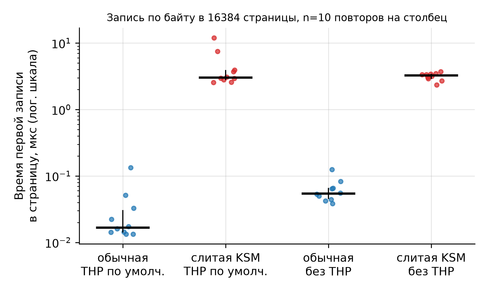
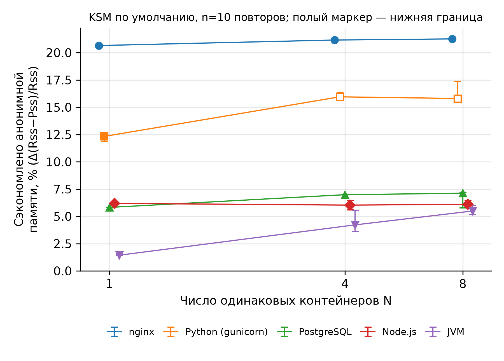
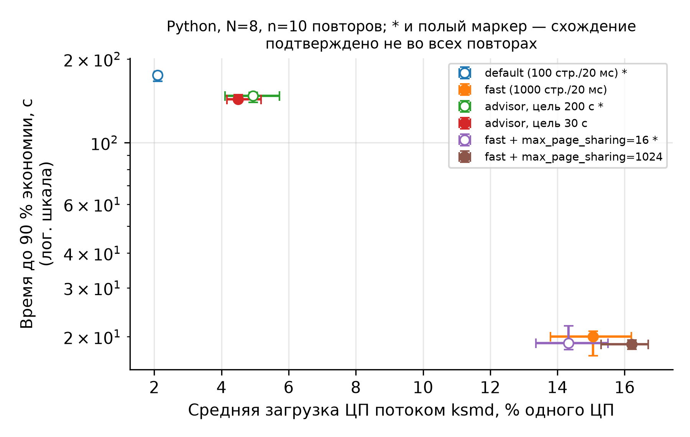
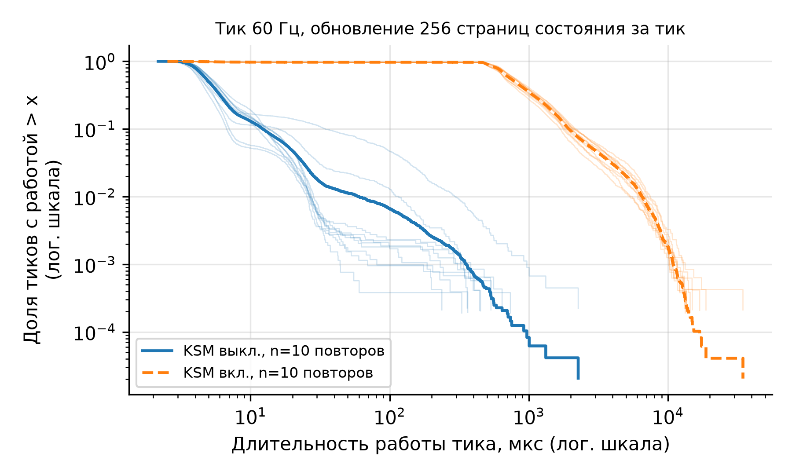
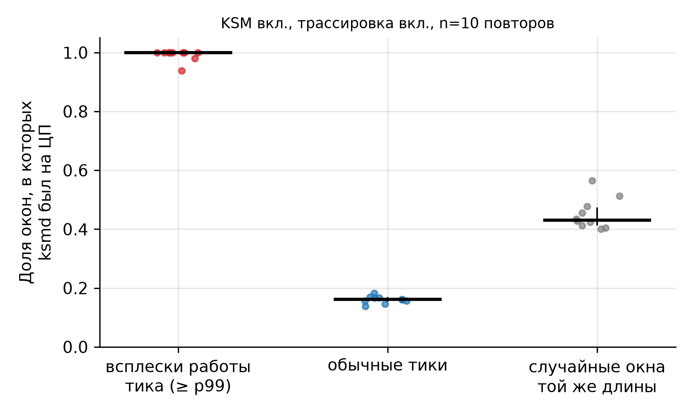
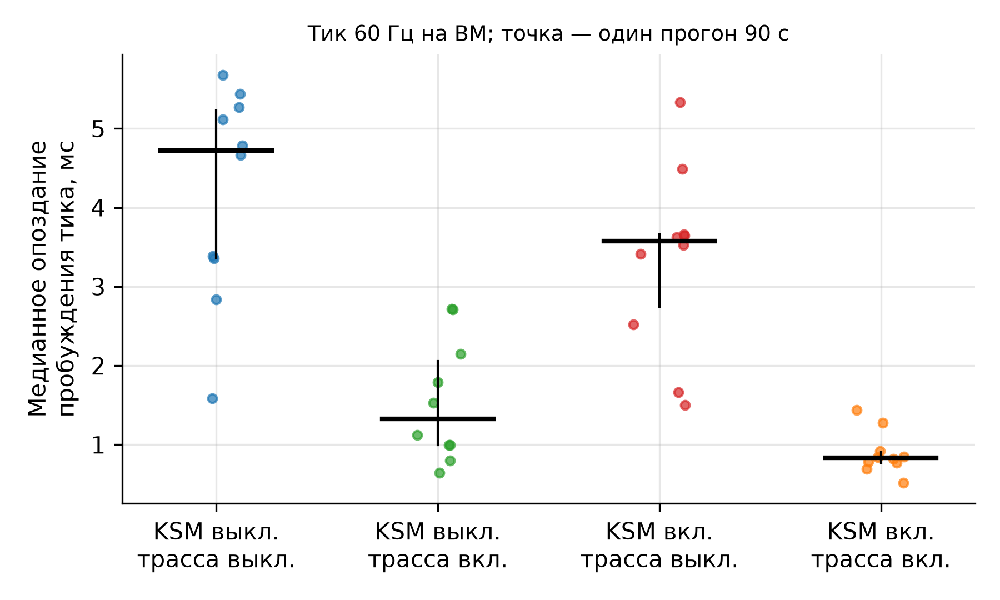
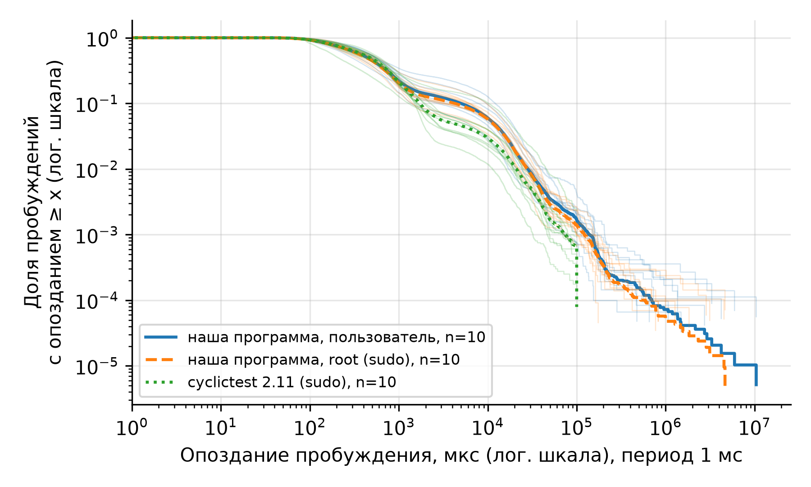

# Этап 1. Атрибуция событий KSM, факторы KSM, реальные нагрузки, подготовка к нативному запуску

## План

Статус: **подтверждён владельцем 2026-10-17** (план из обсуждения после этапа 0 плюс три дополнения владельца: факторы advisor_mode и max_page_sharing; проверка tracepoint-ов и счётчиков до больших серий; связанные работы и осторожное позиционирование).

Роль ВМ на этом этапе (согласовано): полигон для отладки скриптов и методики, плюс метрики, которые от шума таймера почти не зависят (экономия памяти, время схождения, ЦП ksmd). Задержки на ВМ — только как репетиция и сравнение внутри одной серии.

### Шаг 1. До серий: что ядро 7.2.9 даёт для атрибуции (совет владельца — первым делом)
- `perf list 'ksm:*'`, формат полей, счётчики `/proc/vmstat` по ksm.rst, места вызова в коде ядра v7.2.9.
- Пробная запись с синхронизированным стартом perf: слияние → запись в слитые страницы (COW) → проверка, что события и `cow_ksm` ложатся на одну ось CLOCK_MONOTONIC с нашими метками.
- Итог в `docs/decisions.md` (Р12). **Выполнено**, см. «Что сделано».

### Шаг 2. Факторы advisor_mode и max_page_sharing
- По документации и коду 7.2.9: допустимые значения, можно ли менять на лету, что сбрасывается при смене режима. Проверка на живом ядре (`scripts/stage1-mps-check.sh`).
- Итог в `docs/decisions.md` (Р13, Р14). **Выполнено.**

### Шаг 3. Связанные работы и позиционирование
- `docs/references.md`: раздел «Связанные работы». Каждый источник открыт и прочитан по первоисточнику, записывается только прочитанное.
- Формулировки: «освещено фрагментарно», без «впервые». Наследование prctl через fork/exec покрыто selftest-ами ядра, поэтому как вклад не подаётся. Наш вклад здесь — только путь через podman/conmon/crun.

### Шаг 4. Хвосты этапа 0
- `ksm_launch`: режим без prctl (`KSM_LAUNCH_MERGE=0`), чтобы в конфигурации «KSM выкл.» дерево процессов совпадало с «KSM вкл.».
- Мини-серия по расхождению с cyclictest: наша программа от пользователя, наша программа от root, cyclictest; 1 мс, 60 с, 10 повторов (≈40 мин).

### Шаг 5. Безопасный запуск «в один клик» (готовность к нативной системе)
- `scripts/preflight.sh`: ядро и наличие интерфейсов KSM и tracepoint-ов, пакеты, свободная память, нет посторонней нагрузки, нет работающих контейнеров. Только чтение.
- Общая ловушка `trap` в `common.sh`: при любом выходе (ошибка, Ctrl+C, SIGTERM) остановить контейнеры и perf, сделать `run=2`, вернуть параметры KSM по умолчанию.
- Защита памяти: прерывать серию, если `MemAvailable` ниже порога; лимит памяти у контейнеров (`podman --memory`).
- `scripts/run-all.sh` с `--dry-run` (печатает, что будет сделано, ничего не меняя) и выбором серий. Инструкция `docs/running-native.md`.

### Шаг 6. Сбор метрик с атрибуцией
- Сэмплер (0.5 с), трасса perf (`ksm:*` и sched_switch ksmd), `cow_ksm` раз в 10 мс — всё по CLOCK_MONOTONIC (Р12).
- Скрипт привязки: для каждого «плохого» тика/запроса (выше p99 серии) найти события KSM в окне ±X мс; сравнить с той же статистикой для случайных моментов (иначе совпадения могут быть случайными).
- Контроль «трассировка вкл./выкл.»: не вносит ли сам perf задержку.

### Шаг 7. Серии на ВМ
1. **Цена COW** (`ksm_probe --touch-after`): длительность записи в слитую и в неслитую память, 10 повторов. Контроль — тот же объём без KSM.
2. **Реальные нагрузки, память и ЦП**: nginx, Python, Node.js, JVM, PostgreSQL в контейнерах (ksm_launch внутри, Р11), N = 1, 2, 4, 8 одинаковых контейнеров. Метрики: экономия (pages_sharing, сумма Pss контейнеров, AnonPages), время схождения, ЦП ksmd, `general_profit`.
3. **Факторы KSM** (по одному от базовой конфигурации, не полный перебор): темп сканирования (по умолчанию / ускоренный), `advisor_mode` (none / scan-time с целью 200 с и 30 с), `max_page_sharing` (16 / 256 / 1024). На одной-двух нагрузках при N = 8.
4. **Репетиция задержек**: одна нагрузка (nginx под генератором запросов) и тик-программа. KSM вкл./выкл., трассировка вкл./выкл., p99 и атрибуция по шагу 6. Цель — отладить пайплайн, а не получить числа для статьи.

**Бюджет времени.** Сначала пилот по каждой нагрузке (1 повтор), затем расчёт общей длительности. Если пункт 7.2 + 7.3 выходит больше ~10 часов, сокращаю (меньше нагрузок или уровней N) и пишу об этом владельцу до запуска.

**Решение владельца (2026-10-17, после пилота):** «средний» объём, ~10 ч. 7.2 — все 5 нагрузок × N = 1, 4, 8 при KSM по умолчанию; 7.3 — факторы KSM (default, fast, adv200, adv30, mps16, mps1024) только на python при N = 8, с пределом наблюдения 600 с (иначе adv200 упирается в предел). Трассы perf хранятся по схеме «архив + хеши в git» (Р20).

### Шаг 8. Отчёт этапа, журнал, графики, коммит. Остановка.

---

## Что сделано

| Шаг | Статус |
|---|---|
| 1. Tracepoint-ы и счётчики KSM | выполнено: 9 tracepoint-ов работают; для COW tracepoint-а нет, `cow_ksm` опрашивается раз в 10 мс; perf стартует синхронно (Р12) |
| 2. advisor_mode и max_page_sharing | выполнено: по коду 7.2.9 и проверкой на ядре (Р13, Р14) |
| 3. Связанные работы | выполнено: 7 работ по списку владельца + Styx, всё по первоисточникам (`references.md`) |
| 4. Хвосты этапа 0 | выполнено: `KSM_LAUNCH_MERGE=0`; мини-серия cyclictest (гипотеза «root» отвергнута) |
| 5. Безопасный запуск | выполнено: метка контейнеров, восстановление исходных настроек KSM при любом выходе, сторож памяти, preflight, `run-all.sh --dry-run`, `docs/running-native.md`; проверено прерыванием (Р15) |
| 6. Атрибуция | выполнено: `scripts/lib/attribution.py` + синтетический тест с известным ответом; сравнение «всплески / обычные / случайные окна той же длины» |
| 7.1 Цена COW | выполнено, 4 конфигурации × 10 |
| 7.2 Реальные нагрузки × N | выполнено, 150 прогонов; **у Python N=4/8 критерий окончания сработал рано** (см. «Проблемы») |
| 7.3 Факторы KSM | выполнено, Python N=8, 6 настроек × 10 |
| 7.4 Репетиция задержек | выполнено, 4 конфигурации × 10, с атрибуцией |
| Сверх плана | проверка учёта KSM для страниц после fork; хранение трасс «архив + хеши» (Р20, решение владельца) |

## Результаты

Все числа: медиана [Q1–Q3] по 10 повторам, ВМ VirtualBox, ядро 7.2.9 (если не сказано иное).

### 1. На ядре 7.2.9 можно привязывать задержки к работе KSM
9 tracepoint-ов (`ksm_start/stop_scan`, `ksm_merge_with_ksm_page`, `ksm_remove_*`, `ksm_enter/exit`, `ksm_advisor`, `ksm_merge_one_page` — последний только для нулевых страниц) плюс `sched_switch` ksmd и `cow_ksm` (±10 мс) на одной оси CLOCK_MONOTONIC. Проверка: при записи в 16384 слитые страницы `cow_ksm` вырос ровно на 16384 внутри окна записи (`results/raw/stage1-trace-check/20261017-094021/`). Tracepoint-а для COW в ядре нет (`do_wp_page`, `mm/memory.c:4334`). Версии: tracepoint-ы и prctl с 6.4, advisor с 6.8 (по дереву исходников). → `docs/decisions.md` Р12.

### 2. max_page_sharing и advisor
`max_page_sharing`: допустимо 2…INT_MAX. При слитых страницах изменение даёт `EBUSY`, в том числе при `run=0`, так что менять можно только после `run=2`; в admin-guide это не описано. Влияние на экономию точно по теории 16·⌈256/M⌉ в 15/15 прогонах (`results/raw/stage1-mps-check/20261017-094158/`). Advisor сбрасывает `pages_to_scan` при смене режима, а время прохода меряет в целых секундах. → Р13, Р14.

### 3. Учёт экономии: `pages_sharing` завышает её для процессов после fork
Родитель + потомок после fork, 64 МиБ: `pages_sharing` = 32512 (2P − K) против 16128 (P − K) у одного процесса. При этом реальная экономия одинакова: Pss 64.1 → 1.1 МиБ, Δ(Rss − Pss) = 63.0 МиБ в обоих случаях, 5/5 повторов (`results/raw/stage1-fork-share-check/20261017-110556/`). На реальных нагрузках N=8 расхождение у PostgreSQL 9.3 против 7.0 МиБ (+33 %). Главная метрика — Δ(RssAnon − PssAnon) (Р16).

### 4. Цена COW: ≈ 3 мкс на страницу
Первая запись в слитую страницу — 3.02 [2.84–3.88] мкс (THP по умолчанию) и 3.26 [2.95–3.39] мкс (без THP) против 0.017 [0.014–0.030] и 0.054 [0.046–0.065] мкс в обычную. `cow_ksm` = 16384 в каждом слитом прогоне, 0 в контроле (`results/summary/stage1-cow-cost.csv`). Порядок величины совпадает с 7.2 мкс в ВМ KVM (NDSS'22).

### 5. Экономия на реальных нагрузках определяется классом приложения, а не N
KSM по умолчанию, доля анонимной памяти, которую не пришлось хранить (`results/summary/stage1-workloads.csv`):

| | N=1 | N=4 | N=8 | t90 при N=8 |
|---|---|---|---|---|
| nginx | 20.7 % | 21.2 % | 21.3 % (13.6 МиБ) | 9 с |
| Python (gunicorn) | 12.3 % | ≥ 16.0 %* | ≥ 15.8 %* (≥ 189 МиБ) | 172 с |
| PostgreSQL | 5.8 % | 7.0 % | 7.1 % (7.0 МиБ) | 13 с |
| Node.js | 6.2 % | 6.0 % | 6.1 % (16.1 МиБ) | 40 с |
| JVM | 1.4 % | 4.2 % | 5.5 % (28.7 МиБ) | 87 с |

\* нижняя граница: схождение не подтверждено (N=4 — в 5/10, N=8 — в 0/10 прогонов). После полного схождения (настройка `fast`, серия 7.3) Python N=8 даёт 210 [209–213] МиБ = 17.6 %. ksmd занимает 0.6–2.7 % одного ЦП.

### 6. Настройки KSM: скорость против ЦП; advisor — посередине
Python, N=8 (`results/summary/stage1-workloads-factors.csv`): `fast` — t90 20 [17–21] с при ksmd 15.1 [13.8–16.2] %; `default` — 175 [166–179] с при 2.1 [2.0–2.2] % (не сошёлся); advisor (цели 200 и 30 с) — 143–148 с при 4.5–4.9 %, причём цели между собой почти не различаются, а число проходов скачет от 3 до 88. `max_page_sharing` 16/256/1024 на экономию почти не влияет (210 / 210 / 213 МиБ, IQR перекрываются). После схождения экономия 206–213 МиБ при любой настройке.

### 7. Репетиция задержек: KSM растягивает работу тика на два порядка, хвост совпадает с работой ksmd
Модель тик-сервера 60 Гц, 256 страниц «состояния» обновляются тем же байтом за тик (худший случай: цикл «слил → COW»), `results/summary/stage1-latency-rehearsal.csv`:
- работа тика: без KSM p50 5.2 [4.6–5.4] мкс, p99 27 [26.5–28.0] мкс; с KSM p50 807 [735–842] мкс, p99 6.3 [6.1–6.8] мс. p50 объясняется ценой COW (256 × ~3.1 мкс);
- атрибуция: в окнах всплесков (≥ p99) ksmd был на ЦП в 1.00 [1.00–1.00] доле окон, в обычных тиках — 0.16, в случайных окнах той же длины — 0.43. Число COW в окне всплески не отличает;
- эффект наблюдателя на ВМ: трассировка уменьшает **опоздание пробуждения** (p50 4.72 → 1.33 мс без KSM), а **работу тика** не меняет заметно (p99 6.3 против 6.6 мс, IQR перекрываются).

### 8. Расхождение с cyclictest — не из-за root
Своя программа от пользователя и от root неотличима (p90 4.9 и 4.6 мс, ~20 тыс. пробуждений), cyclictest лучше (p90 1.6 мс, ~30 тыс.), `results/summary/stage1-jitter-xcheck.csv`. Гипотеза о втором потоке cyclictest (просыпается каждые 10 мс) согласуется с эффектом наблюдателя из п. 7, но не проверена.

## Проблемы и ограничения

1. **Критерий окончания наблюдения (Р17) срабатывал рано** при медленном сканировании: у Python N=8 при KSM по умолчанию — во всех прогонах, у N=4 — в половине. Данные не выброшены, помечены `conv_ok=0` и в отчёте приведены как нижняя граница. Критерий исправлен (≥ 3 полных прохода + рост ≤ max(1 %, 256 страниц) за 60 с), исправленный скрипт проверен только дымовым прогоном (nginx).
2. **Мои методические ошибки по ходу, все найдены и исправлены:** правка выполняющегося скрипта (данные целы, правило добавлено в скилл); синтетический тест атрибуции сначала проверял не то (выбор всплесков с повторами); неверное имя поля Rss в проверке fork (перезапуск, первая попытка помечена).
3. **ВМ:** абсолютные задержки не для статьи (Л4); есть эффект наблюдателя (Л5); анализ частично шёл параллельно с сериями, с `nice` (Л7).
4. **Модель тика синтетическая и худшая** (каждая запись — COW). Реальные движки — на этапе 3.
5. **Приложения в серии 7.2 простаивают** после прогрева, без запросов. Под нагрузкой экономия и особенно COW будут другими.
6. **«ЦП ksmd за наблюдение»** зависит от длины наблюдения, разной у конфигураций. Корректнее «ЦП до схождения», это на следующий этап.
7. Образ `alpine:3.22` при повторном pull получил новый digest; все digest этапа 1 записаны (`env/vm-oracle/images.txt`).

## Что дальше (предложения на этап 2, требуют подтверждения)

1. **Повторить Python N=4/8 (и JVM N=8) при KSM по умолчанию** с исправленным критерием (~3–4 ч), чтобы закрыть «нижнюю границу» в таблице п. 5.
2. **Уровень 2: задержки под нагрузкой.** Генератор запросов с записью времени каждого запроса (nginx, Python, Node, JVM, PostgreSQL/pgbench), KSM вкл./выкл. через `KSM_LAUNCH_MERGE`, p99/p99.9 с атрибуцией. Проверить гипотезу «хвост = COW + одновременная работа ksmd» (конкуренция за ЦП или блокировки), в том числе привязкой ksmd к отдельному vCPU.
3. **Метрика «ЦП ksmd до схождения»** и факторы на второй нагрузке (JVM).
4. **Нативный Arch:** `scripts/run-all.sh` с preflight. Первыми — мини-серия cyclictest (проверка гипотезы о vCPU), наследование prctl и цена COW, затем выбранные серии этапа 1.
5. **THP как фактор** (always / madvise / never): KSM разбивает huge-страницы, влияние на скорость слияния и на COW пока не измерено.
