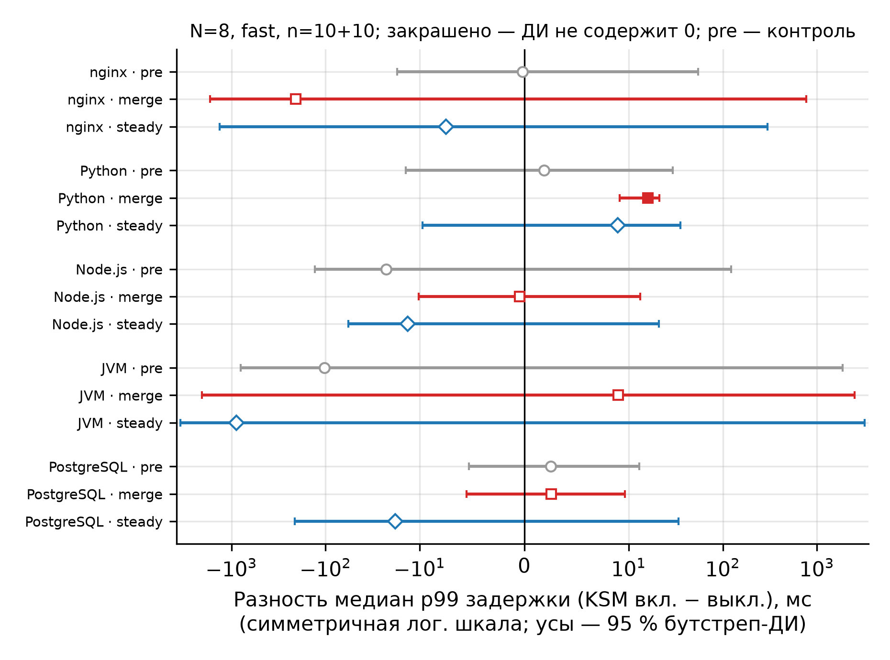
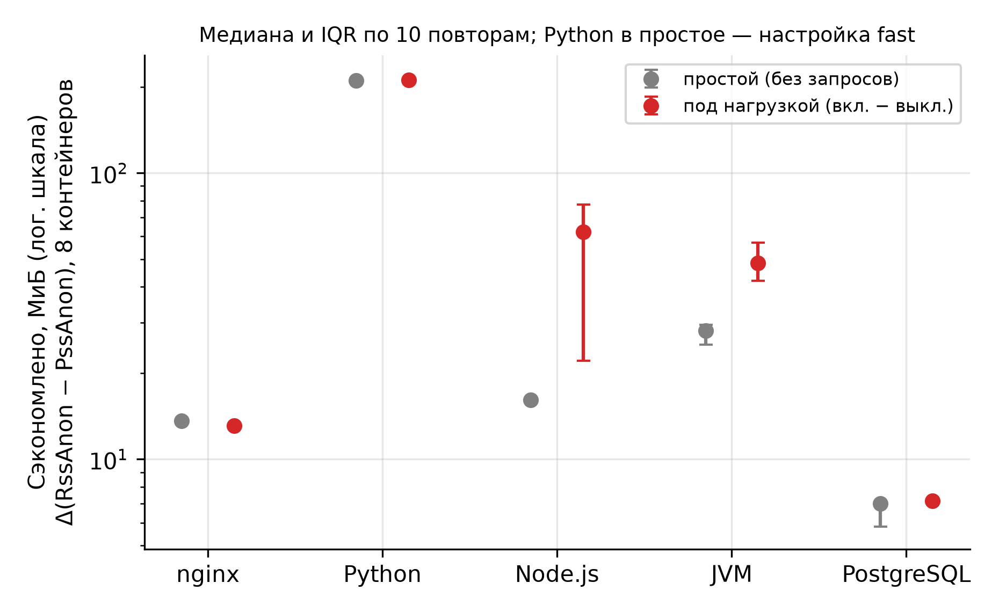
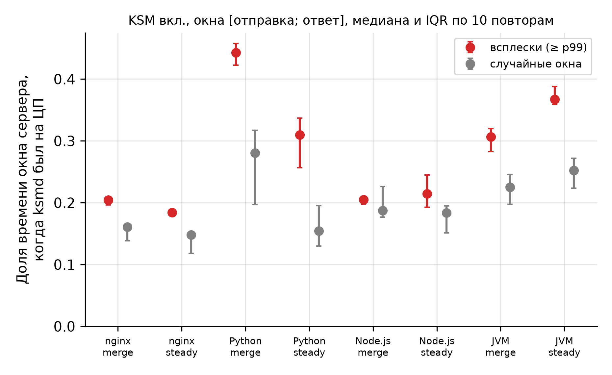
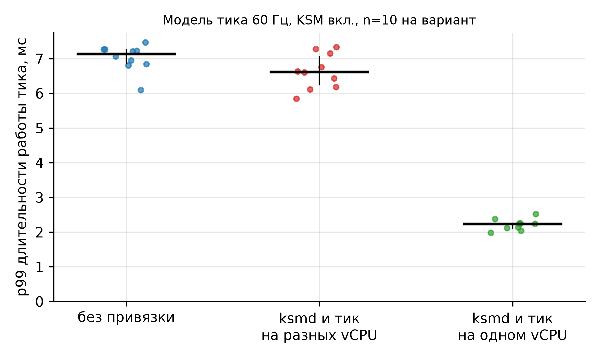
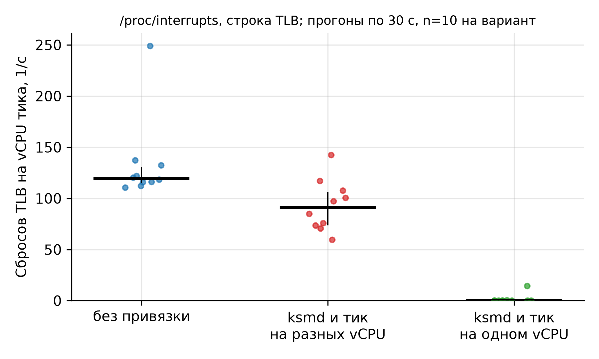

# Этап 2. Влияние KSM на задержку под нагрузкой (уровень 2)

## План

Статус: **подтверждён владельцем 2026-10-18**: основная серия (шаг 4) на всех 5 нагрузках с настройкой `fast` (~16–17 ч машинного времени всего).

**Цель этапа.** Перейти от простаивающих контейнеров (этап 1) к контейнерам **под нагрузкой запросами** и измерить, как KSM меняет p50/p99/p99.9 задержки ответа у пяти классов приложений. Каждый всплеск привязывается к событиям KSM (пайплайн атрибуции этапа 1). Отдельно проверяется гипотеза этапа 1 о механизме хвоста: «COW + одновременная работа ksmd».

**Роль ВМ (как договорились).** На ВМ отлаживается пайплайн и сравниваются конфигурации **внутри одной серии**: одинаковый режим трассировки, перемешанный порядок, ≥ 10 повторов. Абсолютные задержки ВМ в статью не идут (Л4, Л5). В конце этапа готов пакет для нативного прогона.

Проверено перед планом (только чтение / с возвратом): привязку ksmd к ядрам можно менять (`taskset -p`, сейчас 0–3, nice 5; вернул как было); `pgbench` 17.11 есть в образе postgres; `wrk` в официальных репозиториях Arch нет.

### Шаг 1. Закрыть долги этапа 1 (~3–4 ч машинного времени)
- Повторить Python N=4 и N=8 (и JVM N=8 для контроля) при KSM по умолчанию с **исправленным критерием окончания** (≥ 3 полных прохода, Р17), 10 повторов. Итог — сошедшиеся значения вместо нижней границы в таблице этапа 1.
- Метрика **«ЦП ksmd до схождения»** (от включения KSM до момента схождения) в сводке, по уже собранным данным. Тогда сравнение настроек KSM по ЦП не зависит от длины наблюдения.

### Шаг 2. Генератор нагрузки без «coordinated omission»
- **Открытая модель нагрузки:** запросы отправляются по заранее заданному расписанию с постоянной частотой, а задержка считается от **запланированного** момента отправки, а не от фактического. Иначе генератор, ожидающий медленный ответ, перестаёт слать запросы, и хвосты систематически занижаются (известная ошибка «coordinated omission»). Будет решение Р21 с источником.
- HTTP (nginx, Python, Node.js, JVM): свой небольшой генератор на C (keep-alive, несколько соединений, постоянная частота). Для каждого запроса пишутся `t_planned`, `t_sent`, `t_done` (CLOCK_MONOTONIC), статус. Свой, а не готовый, потому что `wrk` в официальных репозиториях нет, а нам нужен лог каждого запроса с метками на общей оси с perf.
- PostgreSQL: `pgbench --rate` (открытая модель) с журналом каждой транзакции (`-l`).
- **Сеть:** генератор работает в сетевом пространстве имён контейнера (loopback), а не через проброс портов rootless-podman. Пользовательский сетевой стек (pasta/slirp) добавил бы свой шум.
- Проверка генератора на эталоне: сервер с известной задержкой (`sleep` фиксированной длины в обработчике) — измеренное распределение должно совпасть с заданным. Плюс проверка, что при искусственной паузе сервера задержка считается от расписания.

### Шаг 3. Пилот: рабочая частота запросов
- Для каждой нагрузки найти частоту, при которой контейнер загружен умеренно (например, ~30–50 % от насыщения по пилоту). Сравнение на насыщении бессмысленно: там задержку определяет очередь, а не KSM.
- Пилот: 1 повтор на нагрузку, оценка длительности серий (как на этапе 1). Если бюджет шага 4 выйдет больше согласованного, — вопрос владельцу до запуска.

### Шаг 4. Основная серия: KSM вкл./выкл. под нагрузкой
- N = 8 контейнеров одной нагрузки, на каждый — свой поток запросов с одинаковой частотой.
- Факторы: KSM вкл./выкл. (`KSM_LAUNCH_MERGE=1/0`, дерево процессов одинаковое) × настройка сканирования (`default`, `fast`). Трассировка включена **во всех** конфигурациях: на ВМ сравниваем только при одинаковом режиме трассировки (Л5).
- Фазы прогона анализируются отдельно: (а) **фаза слияния** — от включения KSM до схождения: ksmd активно пишет-защищает страницы, ожидаются всплески; (б) **устойчивая фаза** — после схождения: остаются COW от записи приложения и фоновое сканирование.
- Метрики: p50/p99/p99.9 задержки по фазам, пропускная способность, ошибки, экономия памяти **под нагрузкой** (Δ(Rss−Pss)), `cow_ksm`, ЦП ksmd, атрибуция всплесков (≥ p99) к работе ksmd / слияниям / COW против обычных запросов и случайных окон той же длины.
- **Статистика сравнения:** для «KSM вкл. против выкл.» — разность медиан по повторам с 95 % бутстреп-интервалом и тест Манна–Уитни. Вывод «KSM ухудшает p99» делается только если интервал не содержит 0.

### Шаг 5. Проверка механизма хвоста (гипотеза этапа 1)
- Гипотеза: самые долгие события — это COW, совпавшие по времени с работой ksmd (конкуренция за ЦП или за блокировки mm/таблиц страниц).
- Опыт: на модели тика (этап 1) и на одной реальной нагрузке (Python) — фактор «ksmd привязан к отдельному vCPU, приложение — к остальным» против «без привязки». Если хвост уходит при развязке по ЦП, причина — конкуренция за ЦП; если остаётся — блокировки. Привязка ksmd возвращается в исходное состояние при любом выходе (расширение `safety_init`).

### Шаг 6. Подготовка нативного прогона
- Серии этапа 2 в реестр `run-all.sh`, preflight дополняется проверками генератора.
- Короткий «нативный набор» по приоритету: мини-серия cyclictest (проверка гипотезы о vCPU), цена COW, репетиция тика, основная серия этапа 2 на 1–2 нагрузках. Запускает владелец на своей машине по `docs/running-native.md`.

### Шаг 7. Отчёт этапа, журнал, графики, коммит, остановка

### Бюджет и вопросы к владельцу
- Оценка до пилота: шаг 1 — ~3–4 ч; шаг 4 — 5 нагрузок × 2 (KSM) × 2 (настройка) × 10 повторов × ~6 мин ≈ 20 ч, это слишком много. **Предлагаю** в шаге 4 настройку сканирования только `fast` (с `default` фаза слияния на Python длится минуты, а на `fast` — секунды, поэтому `fast` удобнее для фазового анализа): 5 × 2 × 10 × ~6 мин ≈ 10 ч. Шаг 5 — ~3 ч. Итого ~16–17 ч машинного времени, точнее после пилота.
- Трассы шага 4 (~15 МБ на прогон × ~100 прогонов ≈ 1.5 ГБ) — по схеме «архив + хеши» (Р20). На диске ВМ свободно 15 ГБ.
- Если бюджет нужно сократить: оставить 3 нагрузки (nginx, Python, PostgreSQL — разные механизмы: малая память, prefork-интерпретатор, СУБД с shmem) — ~6 ч на шаг 4.

---

## Что сделано

| Шаг | Статус |
|---|---|
| 1. Долги этапа 1 | выполнено: повтор Python N=4/8 и JVM N=8 с исправленным критерием (30 прогонов); метрика «ЦП ksmd до 90/99 % экономии» |
| 2. Генератор нагрузки | выполнено: `loadgen` (открытая модель, задержка от расписания, Р21); проверка на эталоне — PASS с третьей попытки (первые две выявили слабости эталона и самой проверки, а не генератора); pgbench `--rate` проверен по документации и исходнику |
| 3. Пилот частот | выполнено, дважды: первый нашёл две ошибки (`Connection: close` у gunicorn, Нейгл и отложенный ACK у JDK HttpServer) — исправлены |
| 4. Основная серия | выполнено: 5 нагрузок × KSM вкл./выкл. × 10, N=8, `fast`, трасса во всех прогонах (100 прогонов) |
| 5. Механизм хвоста | выполнено: привязка ksmd на модели тика (30 прогонов) и на Python под нагрузкой (20 прогонов); сверх плана — счётчики сбросов TLB (30 прогонов по 30 с) |
| 6. Нативный пакет | выполнено: серии этапа 2 в `run-all.sh`, раздел в `docs/running-native.md` |
| Попутно | 203 анонимных тома podman (8.6 ГБ) удалены после проверки, контейнеры теперь удаляются с `-v`; журналы запросов хранятся по схеме «архив + хеши» |

## Результаты

ВМ VirtualBox, ядро 7.2.9; медиана [Q1–Q3] по 10 повторам; «разн.» — разность медиан с 95 % бутстреп-ДИ.

### 1. Экономия памяти: нижние границы этапа 1 закрыты
KSM по умолчанию с исправленным критерием (`results/summary/stage2-rerun*.csv`): Python N=4 — 97.0 [93.6–98.6] МиБ (16.1 %), N=8 — 198.9 [196.3–202.3] МиБ (16.6 %), JVM N=8 — 28.1 МиБ (совпал с этапом 1). Асимптота Python N=8 при `fast` — 210 МиБ (17.6 %): после 3 проходов при скорости по умолчанию прирост ещё не полностью закончен.

Суммарная работа ksmd до 90 % экономии почти одинакова при всех настройках (Python N=8: 2.4–3.7 с ЦП). Ускорение не делает слияние дороже, оно сжимает ту же работу во времени, повышая пиковую загрузку.

### 2. Под нагрузкой KSM значимо ухудшает хвост задержки только у Python, и только во время слияния

`results/summary/stage2-load-compare.csv`:
- Python, фаза слияния: p99 **33.0 [27.8–36.3] мс против 16.9 [15.1–18.7] мс**, разн. +16.1 мс, ДИ [9.1; 21.2], p = 0.0004. В устойчивой фазе +8.9 мс, ДИ [−9.7; 35.3]; в контрольной фазе pre +1.9 мс, ДИ [−14; 29].
- nginx, Node.js, JVM, PostgreSQL: ни в одной фазе ДИ разности p50/p99/p99.9 не исключает 0. На ВМ разброс по повторам больше возможного эффекта.
- Время сервера p99 с KSM по точечной оценке выше у всех (+0.8…+7.8 мс), но ДИ содержат 0. Ошибок — 0 из 35.9 млн запросов (`stage2-load-per-run.csv`).

### 3. Экономия памяти под нагрузкой не меньше, чем в простое

Вклад KSM (вкл. − выкл., Δ(Rss−Pss)): Python 211 МиБ, Node.js 62, JVM 48, nginx 13, PostgreSQL 7. У Node.js и JVM под нагрузкой экономия больше, чем в простое (16 и 28 МиБ).

### 4. Всплески времени сервера совпадают с работой ksmd

Доля времени окна сервера, когда ksmd был на ЦП, у всплесков (≥ p99) против случайных окон той же длины: Python 0.44 / 0.28 (слияние) и 0.31 / 0.16 (устойчивая фаза); JVM 0.31 / 0.23 и 0.37 / 0.25; nginx 0.20 / 0.16 и 0.18 / 0.15; Node.js 0.21 / 0.19 и 0.21 / 0.18 (у Node.js IQR перекрываются). По окнам **сквозной** задержки картина обратная: самые долгие события на ВМ — её остановки, когда стоит и ksmd (Р22).

### 5. Механизм: хвост создаёт одновременная работа ksmd на другом ЦП, вместе с межпроцессорными сбросами TLB

Модель тика 60 Гц (`stage2-ksmd-pin*.csv`):

| | без привязки | ksmd и тик на разных vCPU | на одном vCPU |
|---|---|---|---|
| p99 работы тика, мс (90 с) | 7.14 [6.87–7.26] | 6.62 [6.25–7.06] | **2.24 [2.12–2.26]** |
| p99 работы тика, мс (30 с) | 7.02 | 6.92 | **2.16** |
| сбросов TLB на vCPU тика, 1/с | 119 [116–130] | 91 [74–106] | **0.13 [0.08–0.23]** |
| всплески с ksmd на ЦП / случайные окна | 1.00 / 0.44 | 1.00 / 0.40 | 0.05 / 0.18 |

Развести ksmd и приложение по разным ЦП не помогает; совместить их на одном ЦП — помогает втрое. Вместе с хвостом исчезают межпроцессорные сбросы TLB. На Python под нагрузкой при ksmd на отдельном vCPU всплески времени сервера совпадают с его работой в 2.6–2.8 раза чаще случайного. Вывод осторожный: связь с одновременной работой и сбросами TLB установлена как совпадение, блокировки как сопутствующий механизм не исключены, а в ВМ межпроцессорные прерывания особенно дороги.

## Проблемы и ограничения

1. **ВМ** (Л4, Л5, Л8): шум шире эффектов у 4 из 5 нагрузок; опоздание генератора входит в сквозную задержку; межпроцессорные прерывания дороже, чем на железе.
2. **Ошибки, найденные и исправленные по ходу:** эталон проверки генератора зависел от таймеров ВМ (2 попытки); генератор не учитывал `Connection: close`; JDK HttpServer без TCP_NODELAY добавлял ~40 мс; признак атрибуции «хоть раз в окне» насыщался; под нагрузкой Δ(Rss−Pss) без KSM отрицательна у PostgreSQL; накопились тома podman. Данных с этими ошибками в итоговых сводках нет.
3. **Python + привязка:** вариант split отнимает у приложения vCPU, абсолютные задержки не сравнимы.
4. **JVM:** базовая фаза искажена прогревом JIT.
5. Нагрузка умеренная, одна частота на нагрузку. Зависимость эффекта от частоты не изучалась.
6. Сессия агента обрывалась во время серии. Серия в tmux продолжилась и завершилась с кодом 0, сторож перезапущен вручную.

## Что дальше (предложения, требуют подтверждения)

1. **Нативный прогон** (самое важное): `run-all.sh` с preflight; по приоритету — `xcheck`, `cow-cost`, `ksmd-tlb`, `ksmd-pin`, затем `load-pilot` и `load` на 2–3 нагрузках. Он покажет, какие эффекты — свойство KSM, а какие — ВМ.
2. **Этап 3: реальные приложения с фиксированным тиком** (Luanti, Godot headless): длительность тика, 1 % low, пропущенные тики, с той же атрибуцией и фактором «ksmd на том же или на другом ЦП».
3. **Механизм:** прямые признаки блокировок (tracepoint-ы `mmap_lock:*`, `tlb:tlb_flush`) рядом со сбросами TLB, чтобы разделить два механизма.
4. **Зависимость от частоты запросов** для Python (25 / 50 / 100 запросов/с) — растёт ли эффект слияния с загрузкой.
5. **Практическая рекомендация, требующая проверки на железе:** держать ksmd на том же ЦП, что и чувствительный к задержке процесс, или наоборот исключать такие процессы из KSM.
